# Agent Board

A Claude Code mod that turns a session's agents into a small pixel-art office. It sits above the prompt box in the desktop app, so you can see what your agents are working on without reading their transcripts.

<p align="center"></p>

## What it does

- **Who is working:** a working agent's head shows above its cubicle and its light is on. Its bubble says what it's on, with its percent and the time left.
- **What kind of work:** an agent running a command walks to the copier and waits in line.
- **Finishing:** its light goes off and its report flies to the pile on the boss's desk. The main agent is the boss, and it keeps its crown.
- **Failures:** a failed agent stays at its desk under an indoor rain cloud, with a red stapler. Failures stay on the board until your next prompt.
- **Workflows:** the directory on the wall lists the stages from the script, with how many of each are done. A count can grow as the script decides what to do next.
- **Any size:** the row only holds who's busy, and everyone else spreads out in tiny cubicles behind, so 600 agents look like a big office rather than a crowd.
- **Fill screen:** the button above the scene, or `/agent-board`, opens the whole building in a pane: a floor for each stage, the boss upstairs, and a whiteboard with a line for everyone working. Mods can't cover the whole window, so a pane is as large as it gets.
- **Hover:** hover an agent for its full task.

With no agents running, the band shrinks to a mug of coffee and one line. In a terminal session you get plain text rows instead of the scene.

## How the numbers work

Claude Code doesn't track how far along an agent is, so the mod asks. It adds one sentence to each new agent's brief and a small `progress` tool, and agents report their steps and what they're doing.

- **Percent** is steps finished out of steps the agent expects, by its own count. For the main agent it comes from its task list, when it keeps one.
- **Time left** is a straight-line estimate from how long the finished steps took. It updates when the agent reports and doesn't tick in between.
- **A workflow's agents** aren't asked, which saves dozens of agents the tokens. Their bubbles say what they are touching instead.
- **An agent that can't or doesn't report**, such as one with a fixed tool list, shows no percent, because nobody knows how far along it is.

This costs a few tokens per report, plus about 100 tokens for the tool's schema on each request.

## Install

At the prompt of a terminal session:

```
/plugin install agent-board --marketplace nickdemari/agent-board
```

Answer `y` to add the marketplace, then choose a scope.

From a shell:

```bash
claude plugin install agent-board --marketplace nickdemari/agent-board
```

In the desktop app, where `/plugin` does not run: click + next to the prompt box, then Plugins, Add marketplace with `nickdemari/agent-board`, then Add plugin.

Agent Board is written against the function-hooks plugin API of Claude Code 2.1.310. That API is early access: it can change between releases, and whether hooks modules load at all depends on your version and account. It draws in the same band as other mods that use the space above the prompt, so one can hide another.

## Checking a change

```bash
claude plugin validate .
claude plugin test .
```

## License

MIT
